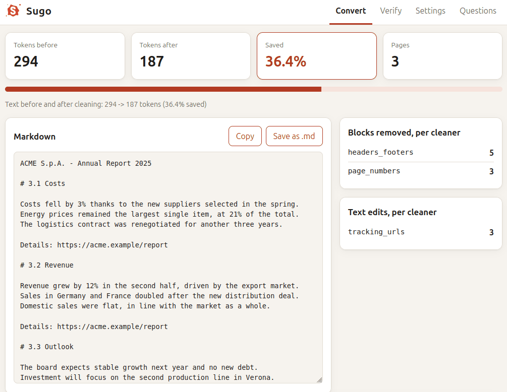
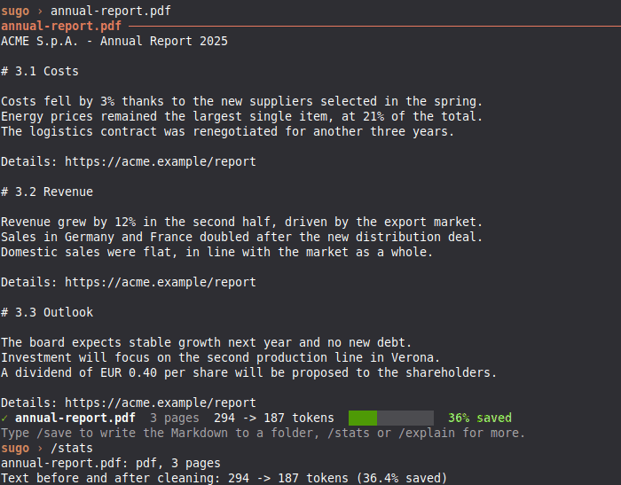
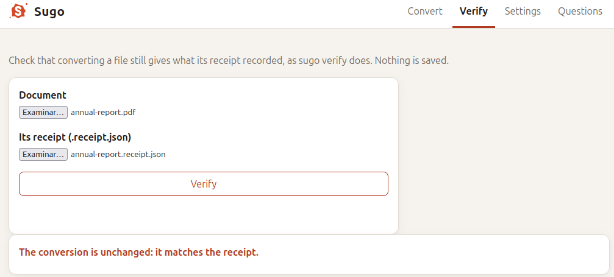
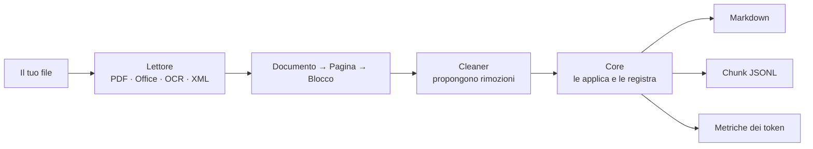

<p align="center">
  <picture>
    <source media="(prefers-color-scheme: dark)" srcset="docs/brand/sugo-logo-dark.svg">
    
  </picture>
</p>

<h1 align="center">Sugo</h1>

<p align="center">
  <strong>Documenti, ridotti.</strong> Dai al tuo LLM il sugo, non l'acqua.
</p>

<p align="center">
  <a href="https://pypi.org/project/sugo-cli/"></a>
  <a href="https://github.com/Muralnick/sugo/actions/workflows/ci.yml"></a>
  
  
  
</p>

<p align="center">
  <a href="#avvio-rapido"><b>Avvio rapido</b></a> ·
  <a href="#cosa-fa">Cosa fa</a> ·
  <a href="#come-si-confronta">Confronto</a> ·
  <a href="docs/ROADMAP.md">Roadmap</a> ·
  🇬🇧 <a href="README.md">English</a>
</p>

---

<table align="center">
  <tr>
    <td align="center"><b>🔒 100% locale</b><br>niente cloud, niente telemetria</td>
    <td align="center"><b>✂️ Meno token</b><br>33–38% con intestazioni ripetute, ~3% su testo legale reale</td>
    <td align="center"><b>🧾 Niente perso in silenzio</b><br>ogni rimozione è registrata e verificabile con <code>sugo verify</code></td>
    <td align="center"><b>🪶 Leggero</b><br>gira con 8 GB di RAM, senza GPU</td>
  </tr>
</table>

Sugo trasforma PDF, file Office, screenshot e immagini in Markdown pulito e compatto, pensato per sistemi RAG, agenti AI e chat con gli LLM. Toglie ciò che costa solo token (intestazioni e piè di pagina ripetuti, numeri di pagina, testo nascosto, parametri di tracciamento, l'interfaccia dell'app intorno a uno screenshot) e tiene il contenuto, le tabelle e la struttura. Tutto gira sul tuo computer: nessuna API cloud, nessuna telemetria, niente viene inviato altrove.

<p align="center">
  
</p>

> "Il sugo del discorso" è il succo, l'essenza; e il sugo, in cucina, si **riduce** finché resta solo il sapore concentrato. È quello che Sugo fa con i tuoi documenti.

## Cosa fa

Un piccolo PDF generato di tre pagine, come lo passa al modello un normale estrattore di testo (le pagine 1 e 3 sono uguali):

```text
ACME S.p.A. - Annual Report 2025                Confidential
3.2 Revenue
Revenue grew by 12% in the second half, driven by the export market.
Details: https://acme.example/report?utm_source=newsletter&utm_medium=email
Page 14 of 120
```

Cosa stampa `sugo report.pdf`:

```markdown
ACME S.p.A. - Annual Report 2025

# 3.1 Costs

Costs fell by 3% thanks to the new suppliers.
Details: https://acme.example/report

# 3.2 Revenue

Revenue grew by 12% in the second half, driven by the export market.
Details: https://acme.example/report

# 3.3 Outlook

The board expects stable growth next year.
Details: https://acme.example/report
```

L'intestazione resta una volta sola invece che su ogni pagina; i numeri di pagina, il "Confidential" ripetuto e i parametri di tracciamento spariscono; il testo è lo stesso. `sugo stats` misura la differenza: **da 180 a 97 token, il 46% in meno** su questo piccolo esempio generato; i documenti reali con meno elementi ripetuti risparmiano molto meno (vedi sotto). Ogni rimozione viene registrata con il cleaner che l'ha fatta e il motivo, così puoi sempre controllare cosa è stato tolto. Il testo illeggibile viene segnato come illeggibile, e la scrittura a mano in una scansione, come una firma, come `[handwriting]`: mai indovinato.

Su un corpus di prova in cinque lingue nessun testo è mancato in nessun documento (su 3 screenshot l'OCR ha letto male qualche carattere, 1–7%). Il risparmio dipende molto dal documento:

| Documento | Token risparmiati |
|---|---|
| Relazione con intestazione, piè di pagina e numeri di pagina ripetuti | 33–38% |
| Screenshot di chat o codice, Markdown invece dell'immagine | 94–98% in meno (Claude, Gemini, OpenAI) |
| Un vero regolamento UE da EUR-Lex, testo legale per lo più sostanziale | 2,9–3,5% |

Ed è veloce anche su un computer normale: su un portatile del 2020 con 4 core, 8 GB di RAM e senza GPU, uno screenshot di telefono fitto diventa testo in 1,5 s; anche su un desktop del 2010 con 2 core, un PDF di 100 pagine si converte in 3,6 s (numeri completi in [TESTING](docs/TESTING.md)).

## Come si confronta

Misurato contro due alternative note, sullo stesso corpus di prova di 31 documenti (26 sintetici creati dal progetto Sugo più 5 PDF reali di un regolamento UE), con lo stesso tokenizer e la stessa verifica del contenuto — metodo completo, dati grezzi e limiti in [docs/comparisons](docs/comparisons/sugo-vs-docling-markitdown.md) (in inglese):

| | Sugo | Docling | MarkItDown |
|---|:---:|:---:|:---:|
| Documenti convertiti senza perdere o rovinare nulla | **28 / 31** | 25 / 31 | 14 / 31 |
| OCR su screenshot di chat/codice | ✅ nessun testo mancante; 1–7% di errori sui caratteri in 3 screenshot con accenti | ⚠️ parole giuste, ordine sbagliato in alcune chat | ❌ output vuoto |
| Legge i PDF di base | ✅ | ✅ | ❌ serve un'estensione |
| Vero regolamento UE in PDF, ogni clausola mantenuta | ✅ | ⚠️ 2 PDF su 5 perdono una clausola | ❌ ognuno ne perde 2–7 |

Uno strumento che perde contenuto "risparmia" token solo sulla carta — non è compressione, è perdita di dati. Ogni numero qui sopra è affiancato a quanto è davvero sopravvissuto alla conversione.

Limiti da tenere presenti: il corpus è piccolo e per lo più sintetico, ed è stato creato dagli autori di Sugo, quindi è un controllo di buon senso, non un verdetto. Sui PDF di report Docling risparmia un po' *più* token di Sugo (circa 38–48% contro 33–38%) senza perdere contenuto; su questo corpus è anche diverse volte più lento. I dati grezzi e la tabella completa per documento sono nel confronto collegato.

## Stato

> [!NOTE]
> **La v0.2.0 è uscita**, su [PyPI](https://pypi.org/project/sugo-cli/) con il nome `sugo-cli` e nel [registro MCP](https://registry.modelcontextprotocol.io/) ufficiale come `io.github.Muralnick/sugo`. Le novità sono nel [changelog](CHANGELOG.md) (in inglese). È ancora 0.x: i contratti possono cambiare, con preavviso, prima della 1.0. Le release sono costruite in modo riproducibile, con SBOM, attestazioni Sigstore e PyPI Trusted Publishing.

| Funziona oggi | In arrivo |
|---|---|
| PDF nativi, DOCX, XLSX, PPTX, XML | v0.1.x: i PDF rifiutati oggi come "broken stream", con il motore PDF scelto da un test su file reali |
| Immagini e screenshot con OCR locale (PNG, JPEG, WEBP) | v0.2: giapponese, cinese, coreano |
| Scansioni: scrittura a mano segnata, carta intestata ripetuta tolta | v0.2: loader per LangChain e LlamaIndex, un'immagine container pubblicata |
| Riconoscimento di screenshot di chat e di codice | v0.3: livello di motore `normal` (Docling): impaginazioni complesse, vecchi file Office |
| Markdown, e chunk in JSON Lines per i database vettoriali | v0.4: cartelle, archivi ed email; configurazione guidata; profili di lavoro |
| Ricevuta di conversione, controllata da `sugo verify` | v0.5: livello di motore `quality` (modello di visione, GPU) |
| Metriche dei token per provider (`sugo stats`) | Più avanti: EPUB e pagine web, servizio in background, controllo delle cartelle |
| Riga di comando, shell interattiva, server MCP per agenti, pagina web locale | |
| Interfaccia e regole del testo in inglese, italiano, spagnolo, francese, tedesco | |

Il piano completo è nella [roadmap](docs/ROADMAP.md) (in inglese).

## Avvio rapido

Sugo richiede Python 3.12, 3.13 o 3.14. L'installazione occupa circa 400 MB su disco, perché porta con sé la libreria PDF, il motore OCR e i suoi modelli. Il modo più semplice per installarlo è [uv](https://docs.astral.sh/uv/):

```bash
uv tool install sugo-cli
```

Oppure con pip:

```bash
pip install sugo-cli
```

Se dopo l'installazione con pip il comando `sugo` "non è riconosciuto" o "non è stato trovato", pip lo ha messo in una cartella in cui il sistema non cerca. Succede su Windows quando pip installa solo per il tuo utente ("Defaulting to user installation"). Puoi installare con `uv tool install sugo-cli` ed eseguire una volta `uv tool update-shell`, oppure aggiungere al `Path` la cartella indicata da pip nel suo avviso (su Windows, `%APPDATA%\Python\Python3XX\Scripts`) e aprire un nuovo terminale.

> [!TIP]
> Il pacchetto si chiama `sugo-cli` perché il nome `sugo` su PyPI è tenuto da un progetto estraneo e vuoto (è aperta una richiesta di trasferimento). Il comando installato resta `sugo`; funziona anche `sugo-cli`. Le vecchie istruzioni con `sugo-cli[lite]` funzionano ancora: ora tutto è incluso di serie.

Per usare invece l'ultima versione di sviluppo dal codice sorgente:

```bash
uv tool install git+https://github.com/Muralnick/sugo
```

Converti un file e stampa il suo Markdown:

```bash
sugo report.pdf
```

Oppure scrivi solo `sugo` per aprire la shell interattiva: trascina un file nella finestra, premi Invio, poi usa `/stats`, `/save` o `/help`.

<p align="center">
  
</p>

Altre cose che puoi fare:

```bash
sugo convert *.pdf -o out/            # un NOME.md per file, nella cartella out/
sugo convert report.pdf --chunks      # chunk in JSON Lines, pronti per il RAG
sugo convert report.pdf --receipt     # scrive anche report.receipt.json (vedi sotto)
sugo stats screenshot.png             # token risparmiati, per provider LLM
sugo clip                             # converte lo screenshot negli appunti
sugo ui                               # apre la pagina web locale: trascini un file, ottieni il Markdown
sugo doctor                           # controlla l'installazione
```

Aggiungi `--json` per un output leggibile da uno script.

### Controllare cosa è stato tolto: la ricevuta

Con `--receipt` (o con l'impostazione della ricevuta nella pagina web), Sugo scrive anche `NOME.receipt.json`: lo SHA-256 del file, la versione di Sugo e le impostazioni usate, il conteggio dei token, ogni blocco tolto o modificato con il cleaner e il motivo, e i blocchi segnati come incerti (per esempio OCR poco sicuro). Più tardi chiunque può controllare che il file si converta ancora nello stesso risultato:

```bash
sugo verify report.pdf report.receipt.json
```

`sugo verify` riconverte il file con le impostazioni salvate nella ricevuta e indica cosa è diverso, solo con l'id dei blocchi, mai il testo. La pagina web fa lo stesso controllo nella scheda Verify:

<p align="center">
  
</p>

La ricevuta dimostra che la *conversione* è fedele al file: niente tolto senza un motivo registrato, niente inventato. Non dice nulla sull'autenticità del documento stesso.

### Usarlo da Python

```python
import sugo

result = sugo.convert("manuale.pdf", chunks=True)
print(result.markdown)
for chunk in result.chunks:
    print(chunk.pages, chunk.text)
```

Di default, dopo la chiamata non resta niente sul disco. La [guida all'API Python](docs/python-api.md) (in inglese) spiega errori, impostazioni e cache.

Per LangChain e LlamaIndex ci sono loader pronti, che danno un documento per ogni chunk di Sugo, con pagine e titoli nei metadati:

```bash
pip install langchain-sugo            # from langchain_sugo import SugoLoader
pip install llama-index-readers-sugo  # from llama_index.readers.sugo import SugoReader
```

### Usarlo da un agente AI (MCP)

Sugo può servire agenti come Claude Code o Codex tramite MCP. Legge solo dentro le cartelle che indichi:

```bash
claude mcp add sugo -- sugo mcp --root ~/Documenti
```

L'agente riceve due strumenti: `convert_document` ed `estimate_savings`. Sugo è anche nel registro MCP ufficiale come `io.github.Muralnick/sugo`, così i client che leggono il registro possono installarlo da lì.

Il server gira sullo stesso computer dell'agente, che lo avvia e ci parla direttamente: i tuoi documenti non lasciano mai quel computer. Per tenerlo in un container, il repository ha un `Dockerfile` (ADR-065); nessuna immagine è ancora pubblicata.

### Disinstallare

Prima fai cancellare a Sugo i suoi file: le impostazioni e la cache delle pagine, che contiene testo dei documenti che hai convertito. Te li elenca, chiede prima di cancellare e poi mostra il comando che toglie il programma (da Sugo 0.1.5):

```bash
sugo uninstall
```

Per cancellare solo la cache e continuare a usare Sugo, usa `sugo cache clear`.

Poi togli il programma nello stesso modo in cui l'hai installato:

```bash
uv tool uninstall sugo-cli
```

Oppure, se hai usato pip:

```bash
pip uninstall sugo-cli
```

Se hai aggiunto Sugo a un agente, toglilo anche da lì, per esempio con `claude mcp remove sugo`.

Disinstallare solo il programma non cancella i file che Sugo ha creato. Stanno solo sul tuo computer; `sugo uninstall` li cancella, oppure puoi cancellarli a mano:

| Cosa | Windows | macOS | Linux |
|---|---|---|---|
| Impostazioni (`config.toml`) | `%LOCALAPPDATA%\sugo` | `~/Library/Application Support/sugo` | `~/.config/sugo` |
| Cache (testo dei documenti convertiti) | `%LOCALAPPDATA%\sugo\Cache` | `~/Library/Caches/sugo` | `~/.cache/sugo` |

Se hai impostato `SUGO_CACHE_DIR`, la cache è in quella cartella. La cache contiene testo dei documenti che hai convertito: cancellala se quei documenti erano privati. Oltre a queste due cartelle e ai file che hai chiesto di scrivere (come l'output di `-o` o le ricevute), Sugo non tiene nient'altro sul disco.

## Su un computer vecchio

Misurato il 3 novembre 2026 su un desktop del 2010: Intel Core i5-650 (2 core, 4 thread, senza AVX), 8 GB di RAM, SSD, nessuna GPU utilizzabile. È più debole della macchina da 8 GB e 4 core per cui Sugo è pensato.

| Operazione | Risultato | Obiettivo |
|---|---|---|
| PDF nativo, 100 pagine, pulizia inclusa | 3,6 s, circa 28 pagine/s | ≥ 20 pagine/s |
| Memoria massima, quel PDF | 98 MB | < 1 GB |
| Screenshot fitto del telefono (30 righe) → testo, OCR | 30 righe su 30, 0% di errori sui caratteri, 411 MB | < 1 GB |
| Stesso screenshot, tempo | 13,7 s | < 2 s |

I documenti nativi restano ben dentro gli obiettivi anche su questa macchina. L'OCR è preciso ma lento su un processore senza AVX; sulla macchina di riferimento con 4 core (Intel i5-10300H, 2020) lo stesso screenshot richiede 1,5 s, dentro l'obiettivo. Dettagli e script sono in [TESTING](docs/TESTING.md) (in inglese).

## File supportati

| Tipo | Formati | Dimensione massima |
|---|---|---|
| Documenti | PDF (con testo), DOCX, XLSX, PPTX | 200 MB |
| Immagini | PNG, JPEG, WEBP (screenshot, foto di testo) | 50 MB |
| Dati | XML | 50 MB |

I vecchi file `.doc`, `.xls` e `.ppt` e i file protetti da password non vengono letti: salvane prima una nuova copia.

## Come funziona



Ogni lettore trasforma il file nella stessa struttura di pagine e blocchi. I cleaner *propongono* soltanto le modifiche; il core le applica e segna ogni blocco rimosso con chi l'ha rimosso e perché, invece di cancellarlo. Per questo l'output è controllabile e riproducibile. Il progetto completo è in [ARCHITECTURE](docs/ARCHITECTURE.md) (in inglese).

## Promesse

Sono scritte nei [PRINCIPLES](PRINCIPLES.md) e verificate dai test:

- **Locale per principio.** La conversione non ha mai bisogno di internet. Nessuna API cloud, nessuna telemetria.
- **Niente congetture.** Il testo illeggibile viene segnato come illeggibile, mai riempito.
- **Niente perso in silenzio.** Ogni rimozione viene registrata, con il suo motivo.
- **Metriche oneste.** Il risparmio viene misurato, e Sugo ti dice anche quando inviare l'immagine originale costerebbe meno.
- **Sicuro con file non fidati.** Limiti di dimensione e di tempo, XML letto in modo sicuro, modelli verificati con checksum. Vedi il [modello delle minacce](docs/THREAT_MODEL.md).

## Documentazione

La documentazione tecnica è in inglese.

| Documento | Contenuto |
|---|---|
| [ARCHITECTURE](docs/ARCHITECTURE.md) | Progetto completo del sistema |
| [PYTHON API](docs/python-api.md) | Usare Sugo dal proprio codice Python |
| [FEATURES](docs/FEATURES.md) | Funzioni per livello di motore, profili di lavoro, formati supportati |
| [THREAT_MODEL](docs/THREAT_MODEL.md) | Analisi di sicurezza |
| [TESTING](docs/TESTING.md) | Test, benchmark, obiettivi di prestazione |
| [ROADMAP](docs/ROADMAP.md) | Piano di sviluppo e contenuto della prima versione |
| [ADR](docs/adr/) | Registro delle decisioni di architettura |
| [PRINCIPLES](PRINCIPLES.md) | Le promesse che Sugo non infrange mai |
| [AI_WORKFLOW](AI_WORKFLOW.md) | Come questo progetto viene costruito con l'aiuto dell'AI |

## Contribuire e sicurezza

Vedi [CONTRIBUTING](CONTRIBUTING.md). Le vulnerabilità vanno segnalate in privato, come descritto in [SECURITY](SECURITY.md), non nelle issue pubbliche.

## Licenza

AGPL-3.0-or-later (vedi [ADR-010](docs/adr/ADR-010-license.md)).
