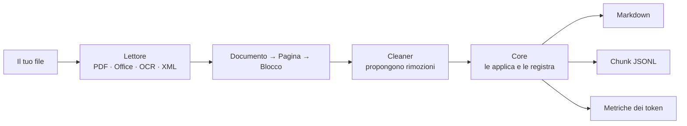

<p align="center">
  <picture>
    <source media="(prefers-color-scheme: dark)" srcset="docs/brand/sugo-logo-dark.svg">
    
  </picture>
</p>

<h1 align="center">Sugo</h1>

<p align="center">
  <strong>Documenti, ridotti.</strong> Dai al tuo LLM il sugo, non l'acqua.
</p>

<p align="center">
  <a href="https://github.com/Muralnick/sugo/actions/workflows/ci.yml"></a>
  
  
  
</p>

<p align="center">
  🇬🇧 <a href="README.md">Read in English</a>
</p>

---

Sugo trasforma PDF, file Office, screenshot e immagini in Markdown pulito e compatto, pensato per sistemi RAG, agenti AI e chat con gli LLM. Toglie ciò che costa solo token (intestazioni e piè di pagina ripetuti, numeri di pagina, testo nascosto, parametri di tracciamento, l'interfaccia dell'app intorno a uno screenshot) e tiene il contenuto, le tabelle e la struttura. Tutto gira sul tuo computer: nessuna API cloud, nessuna telemetria, niente viene inviato altrove.

> "Il sugo del discorso" è il succo, l'essenza; e il sugo, in cucina, si **riduce** finché resta solo il sapore concentrato. È quello che Sugo fa con i tuoi documenti.

## Cosa fa

Un PDF di tre pagine, come lo passa al modello un normale estrattore di testo (le pagine 1 e 3 sono uguali):

```text
ACME S.p.A. - Annual Report 2025                Confidential
3.2 Revenue
Revenue grew by 12% in the second half, driven by the export market.
Details: https://acme.example/report?utm_source=newsletter&utm_medium=email
Page 14 of 120
```

Cosa stampa `sugo report.pdf`:

```markdown
ACME S.p.A. - Annual Report 2025

# 3.1 Costs

Costs fell by 3% thanks to the new suppliers.
Details: https://acme.example/report

# 3.2 Revenue

Revenue grew by 12% in the second half, driven by the export market.
Details: https://acme.example/report

# 3.3 Outlook

The board expects stable growth next year.
Details: https://acme.example/report
```

L'intestazione resta una volta sola invece che su ogni pagina; i numeri di pagina, il "Confidential" ripetuto e i parametri di tracciamento spariscono; il testo è lo stesso. `sugo stats` misura la differenza: **da 180 a 97 token, il 46% in meno** su questo piccolo esempio. Ogni rimozione viene registrata con il cleaner che l'ha fatta e il motivo, così puoi sempre controllare cosa è stato tolto. Il testo illeggibile viene segnato come illeggibile, mai indovinato.

Lo stesso vale su un corpus di prova in cinque lingue, senza perdere nulla di sostanziale in nessun documento:

| Documento | Token risparmiati |
|---|---|
| Relazione con intestazione, piè di pagina e numeri di pagina ripetuti | 33–38% |
| Screenshot di chat o codice, Markdown invece dell'immagine | 94–98% in meno (Claude, Gemini, OpenAI) |
| Un vero regolamento UE da EUR-Lex, testo legale per lo più sostanziale | 2,9–3,5% |

Ed è veloce anche su un computer normale, non solo su uno nuovo: su un desktop del 2010 con 2 core e senza GPU, un PDF di 100 pagine si converte in 3,6 s e uno screenshot di telefono in 13,7 s (numeri completi in [TESTING](docs/TESTING.md)).

## Stato

**Alpha.** La prima versione, la v0.1, è in via di completamento: tutto ciò che segue funziona già installando dal codice sorgente. Il pacchetto su PyPI arriverà con la v0.1.

| Funziona oggi | In arrivo |
|---|---|
| PDF nativi, DOCX, XLSX, PPTX, XML | Cleaner per libri scansionati, EPUB, email, pagine web |
| Immagini e screenshot con OCR locale (PNG, JPEG, WEBP) | Tabelle più grandi, livelli di motore `normal` e `quality` |
| Riconoscimento di screenshot di chat e di codice | Giapponese, cinese, coreano |
| Markdown, e chunk in JSON Lines per i database vettoriali | Shell interattiva, configurazione guidata |
| Metriche dei token per provider (`sugo stats`) | Servizio in background e controllo delle cartelle |
| Riga di comando, server MCP per agenti, pagina web locale | Profili di lavoro e ricette |
| Interfaccia e regole del testo in inglese, italiano, spagnolo, francese, tedesco | |

Il piano completo è nella [roadmap](docs/ROADMAP.md) (in inglese).

## Avvio rapido

Sugo richiede Python 3.12 e [uv](https://docs.astral.sh/uv/).

```bash
uv tool install git+https://github.com/Muralnick/sugo
```

Converti un file e stampa il suo Markdown:

```bash
sugo report.pdf
```

Altre cose che puoi fare:

```bash
sugo convert *.pdf -o out/            # un NOME.md per file, nella cartella out/
sugo convert report.pdf --chunks      # chunk in JSON Lines, pronti per il RAG
sugo stats screenshot.png             # token risparmiati, per provider LLM
sugo clip                             # converte lo screenshot negli appunti
sugo ui                               # apre la pagina web locale: trascini un file, ottieni il Markdown
sugo doctor                           # controlla l'installazione
```

Aggiungi `--json` per un output leggibile da uno script.

### Usarlo da un agente AI (MCP)

Sugo può servire agenti come Claude Code o Codex tramite MCP. Legge solo dentro le cartelle che indichi:

```bash
claude mcp add sugo -- sugo mcp --root ~/Documenti
```

L'agente riceve due strumenti: `convert_document` ed `estimate_savings`.

## Su un computer vecchio

Misurato il 3 novembre 2026 su un desktop del 2010: Intel Core i5-650 (2 core, 4 thread, senza AVX), 8 GB di RAM, SSD, nessuna GPU utilizzabile. È più debole della macchina da 8 GB e 4 core per cui Sugo è pensato.

| Operazione | Risultato | Obiettivo |
|---|---|---|
| PDF nativo, 100 pagine, pulizia inclusa | 3,6 s, circa 28 pagine/s | ≥ 20 pagine/s |
| Memoria massima, quel PDF | 98 MB | < 1 GB |
| Screenshot fitto del telefono (30 righe) → testo, OCR | 30 righe su 30, 0% di errori sui caratteri, 411 MB | < 1 GB |
| Stesso screenshot, tempo | 13,7 s | < 2 s |

I documenti nativi restano ben dentro gli obiettivi anche su questa macchina. L'OCR è preciso ma lento su un processore senza AVX; renderlo più veloce è nella roadmap. Dettagli e script sono in [TESTING](docs/TESTING.md) (in inglese).

## File supportati

| Tipo | Formati | Dimensione massima |
|---|---|---|
| Documenti | PDF (con testo), DOCX, XLSX, PPTX | 200 MB |
| Immagini | PNG, JPEG, WEBP (screenshot, foto di testo) | 50 MB |
| Dati | XML | 50 MB |

I vecchi file `.doc`, `.xls` e `.ppt` e i file protetti da password non vengono letti: salvane prima una nuova copia.

## Come funziona



Ogni lettore trasforma il file nella stessa struttura di pagine e blocchi. I cleaner *propongono* soltanto le modifiche; il core le applica e segna ogni blocco rimosso con chi l'ha rimosso e perché, invece di cancellarlo. Per questo l'output è controllabile e riproducibile. Il progetto completo è in [ARCHITECTURE](docs/ARCHITECTURE.md) (in inglese).

## Promesse

Sono scritte nei [PRINCIPLES](PRINCIPLES.md) e verificate dai test:

- **Locale per principio.** La conversione non ha mai bisogno di internet. Nessuna API cloud, nessuna telemetria.
- **Niente congetture.** Il testo illeggibile viene segnato come illeggibile, mai riempito.
- **Niente perso in silenzio.** Ogni rimozione viene registrata, con il suo motivo.
- **Metriche oneste.** Il risparmio viene misurato, e Sugo ti dice anche quando inviare l'immagine originale costerebbe meno.
- **Sicuro con file non fidati.** Limiti di dimensione e di tempo, XML letto in modo sicuro, modelli verificati con checksum. Vedi il [modello delle minacce](docs/THREAT_MODEL.md).

## Documentazione

La documentazione tecnica è in inglese.

| Documento | Contenuto |
|---|---|
| [ARCHITECTURE](docs/ARCHITECTURE.md) | Progetto completo del sistema |
| [FEATURES](docs/FEATURES.md) | Funzioni per livello di motore, profili di lavoro, formati supportati |
| [THREAT_MODEL](docs/THREAT_MODEL.md) | Analisi di sicurezza |
| [TESTING](docs/TESTING.md) | Test, benchmark, obiettivi di prestazione |
| [ROADMAP](docs/ROADMAP.md) | Piano di sviluppo e contenuto della prima versione |
| [ADR](docs/adr/) | Registro delle decisioni di architettura |
| [PRINCIPLES](PRINCIPLES.md) | Le promesse che Sugo non infrange mai |
| [AI_WORKFLOW](AI_WORKFLOW.md) | Come questo progetto viene costruito con l'aiuto dell'AI |

## Contribuire e sicurezza

Vedi [CONTRIBUTING](CONTRIBUTING.md). Le vulnerabilità vanno segnalate in privato, come descritto in [SECURITY](SECURITY.md), non nelle issue pubbliche.

## Licenza

AGPL-3.0-or-later (vedi [ADR-010](docs/adr/ADR-010-license.md)).
