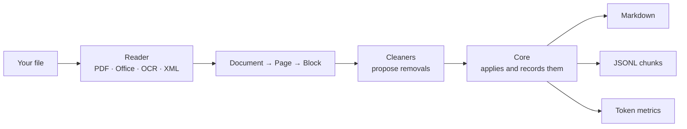

<p align="center">
  <picture>
    <source media="(prefers-color-scheme: dark)" srcset="https://raw.githubusercontent.com/Muralnick/sugo/main/docs/brand/sugo-logo-dark.svg">
    
  </picture>
</p>

<h1 align="center">Sugo</h1>

<!-- mcp-name: io.github.Muralnick/sugo -->

<p align="center">
  <strong>Documents, reduced.</strong> Feed your LLM the sauce, not the water.
</p>

<p align="center">
  <a href="https://pypi.org/project/sugo-cli/"></a>
  <a href="https://github.com/Muralnick/sugo/actions/workflows/ci.yml"></a>
  
  
  
</p>

<p align="center">
  <a href="#quick-start"><b>Quick start</b></a> ·
  <a href="#what-it-does">What it does</a> ·
  <a href="#how-it-compares">Comparison</a> ·
  <a href="#use-it-from-an-ai-agent-mcp">MCP</a> ·
  <a href="https://github.com/Muralnick/sugo/blob/main/docs/ROADMAP.md">Roadmap</a> ·
  🇮🇹 <a href="https://github.com/Muralnick/sugo/blob/main/README.it.md">Italiano</a>
</p>

---

<table align="center">
  <tr>
    <td align="center"><b>🔒 100% local</b><br>no cloud, no telemetry</td>
    <td align="center"><b>✂️ Fewer tokens</b><br>33–38% with repeated headers, ~3% on real legal text</td>
    <td align="center"><b>🧾 Nothing lost silently</b><br>every removal is recorded</td>
    <td align="center"><b>🪶 Light</b><br>runs on 8 GB RAM, no GPU</td>
  </tr>
</table>

Sugo turns PDFs, Office files, screenshots and images into clean, compact Markdown for RAG systems, AI agents and LLM chats. It removes what only costs tokens (repeated headers and footers, page numbers, hidden text, tracking parameters, app chrome around a screenshot) and keeps the content, the tables and the structure. Everything runs on your computer: no cloud API, no telemetry, nothing sent anywhere.

> In Italian, *il sugo del discorso* means "the gist", and a *sugo* is a sauce you **reduce** until only the concentrated flavour remains. That is what Sugo does to your documents.

## What it does

A small generated three-page PDF, as a plain text extractor gives it to your model (pages 1 and 3 look the same):

```text
ACME S.p.A. - Annual Report 2025                Confidential
3.2 Revenue
Revenue grew by 12% in the second half, driven by the export market.
Details: https://acme.example/report?utm_source=newsletter&utm_medium=email
Page 14 of 120
```

What `sugo report.pdf` prints:

```markdown
ACME S.p.A. - Annual Report 2025

# 3.1 Costs

Costs fell by 3% thanks to the new suppliers.
Details: https://acme.example/report

# 3.2 Revenue

Revenue grew by 12% in the second half, driven by the export market.
Details: https://acme.example/report

# 3.3 Outlook

The board expects stable growth next year.
Details: https://acme.example/report
```

The header is kept once instead of on every page; the page numbers, the repeated "Confidential" and the tracking parameters are gone; the text is the same. `sugo stats` measures the difference: **180 → 97 tokens, 46% saved** on this small generated example; real documents with less page furniture save much less (see below). Every removal is recorded with the cleaner that made it and the reason, so you can always check what was dropped. Text that cannot be read is marked as illegible, never guessed.

Across a benchmark corpus in five languages, no text went missing in any document (on 3 screenshots the OCR misread a few characters, 1–7%). Savings depend heavily on the document:

| Document | Tokens saved |
|---|---|
| Report with a running header, footer and page numbers | 33–38% |
| Chat or code screenshot, Markdown vs. sending the image itself | 94–98% cheaper (Claude, Gemini, OpenAI) |
| A real EU regulation from EUR-Lex, mostly substantive legal text | 2.9–3.5% |

And it stays fast on an ordinary computer, not just a new one: on a 2010 desktop with 2 cores and no GPU, a 100-page PDF converts in 3.6 s and a phone screenshot in 13.7 s (full numbers in [TESTING](https://github.com/Muralnick/sugo/blob/main/docs/TESTING.md)).

## How it compares

Measured against two well-known alternatives, on the same 31-document benchmark corpus (26 synthetic documents made by the Sugo project plus 5 real EU-regulation PDFs), with the same tokenizer and the same ground truth — full method, raw numbers and limits in [docs/comparisons](https://github.com/Muralnick/sugo/blob/main/docs/comparisons/sugo-vs-docling-markitdown.md):

| | Sugo | Docling | MarkItDown |
|---|:---:|:---:|:---:|
| Documents converted with nothing lost or garbled | **28 / 31** | 25 / 31 | 14 / 31 |
| OCR on chat/code screenshots | ✅ no text missing; 1–7% character errors on 3 accented screenshots | ⚠️ right words, wrong order on some chats | ❌ empty output |
| Reads PDFs out of the box | ✅ | ✅ | ❌ needs an extra |
| Real EU regulation PDF, every clause kept | ✅ | ⚠️ 2 of 5 drop a clause | ❌ every one drops 2–7 |

A tool that drops content also "saves" tokens on paper — that's data loss, not compression. Every number above is paired with what actually survived the conversion.

Fair caveats: the corpus is small and mostly synthetic, and it was built by the Sugo authors, so treat it as a sanity check, not a verdict. On the report PDFs Docling saves slightly *more* tokens than Sugo (about 38–48% vs 33–38%) without losing content; it is also several times slower on this corpus. Raw data and the full per-document table are in the linked comparison.

## Status

> [!NOTE]
> **v0.1.1 is out**, on [PyPI](https://pypi.org/project/sugo-cli/) as `sugo-cli` (v0.1.0 was the first signed release). It is still 0.x: contracts may change, with notice, before 1.0. Releases are built reproducibly, with an SBOM, Sigstore attestations and PyPI Trusted Publishing.

| Works today | Coming next |
|---|---|
| Native PDFs, DOCX, XLSX, PPTX, XML | Scanned-book cleaners, EPUB, email, web pages |
| Images and screenshots with local OCR (PNG, JPEG, WEBP) | Larger tables, `normal` and `quality` engine levels |
| Chat and code screenshot detection | Japanese, Chinese, Korean |
| Markdown, and JSON Lines chunks for vector databases | Interactive shell, guided setup |
| Token metrics per provider (`sugo stats`) | Background service and folder watcher |
| Command line, MCP server for agents, local web page | Work profiles and recipes |
| Interface and text rules in English, Italian, Spanish, French, German | |

See the [roadmap](https://github.com/Muralnick/sugo/blob/main/docs/ROADMAP.md) for the full plan.

## Quick start

Sugo needs Python 3.12, 3.13 or 3.14. The install is about 400 MB on disk, because the PDF library, the OCR engine and its models come with it. The easiest way to install it is with [uv](https://docs.astral.sh/uv/):

```bash
uv tool install sugo-cli
```

Or with pip:

```bash
pip install sugo-cli
```

If `sugo` is "not recognized" or "not found" after installing with pip, pip put it in a folder your system does not search. This happens on Windows when pip installs for your user only ("Defaulting to user installation"). Either install with `uv tool install sugo-cli` and run `uv tool update-shell` once, or add the folder pip names in its warning (on Windows, `%APPDATA%\Python\Python3XX\Scripts`) to your `Path`, then open a new terminal.

> [!TIP]
> The package is called `sugo-cli` because the name `sugo` on PyPI is held by an unrelated, empty project (a name transfer request is open). The installed command is still `sugo`; `sugo-cli` works too. Older instructions with `sugo-cli[lite]` still work: everything is now included by default.

To run the latest development version from source instead:

```bash
uv tool install git+https://github.com/Muralnick/sugo
```

Convert a file and print its Markdown:

```bash
sugo report.pdf
```

More things you can do:

```bash
sugo convert *.pdf -o out/            # one NAME.md per file, in out/
sugo convert report.pdf --chunks      # chunks as JSON Lines, ready for RAG
sugo stats screenshot.png             # tokens saved, per LLM provider
sugo clip                             # convert the screenshot in your clipboard
sugo ui                               # open the local web page: drop a file, get Markdown
sugo doctor                           # check the installation
```

Add `--json` for output a script can read.

### Use it from an AI agent (MCP)

Sugo can serve agents such as Claude Code or Codex over MCP. It reads only inside the folders you name:

```bash
claude mcp add sugo -- sugo mcp --root ~/Documents
```

The agent gets two tools: `convert_document` and `estimate_savings`.

### Uninstall

Remove the program the same way you installed it:

```bash
uv tool uninstall sugo-cli
```

Or, if you used pip:

```bash
pip uninstall sugo-cli
```

If you added Sugo to an agent, remove it there too, for example `claude mcp remove sugo`.

Uninstalling the program does not delete the files Sugo created. They are only on your computer, and you can delete them by hand:

| What | Windows | macOS | Linux |
|---|---|---|---|
| Settings (`config.toml`) | `%LOCALAPPDATA%\sugo` | `~/Library/Application Support/sugo` | `~/.config/sugo` |
| Cache (text of converted documents) | `%LOCALAPPDATA%\sugo\Cache` | `~/Library/Caches/sugo` | `~/.cache/sugo` |

If you set `SUGO_CACHE_DIR`, the cache is in that folder instead. The cache holds text from the documents you converted, so delete it if those documents were private. Apart from these two folders and the files you asked it to write (such as `-o` output or receipts), Sugo keeps nothing else on disk.

## On an old computer

Measured on 2026-11-03 on a 2010 desktop: Intel Core i5-650 (2 cores, 4 threads, no AVX), 8 GB RAM, SSD, no usable GPU. Weaker than the 8 GB, 4-core machine Sugo targets.

| Task | Result | Target |
|---|---|---|
| Native PDF, 100 pages, cleaning included | 3.6 s, about 28 pages/s | ≥ 20 pages/s |
| Peak memory, that PDF | 98 MB | < 1 GB |
| Dense phone screenshot (30 lines) → text, OCR | 30 of 30 lines, 0% character errors, 411 MB | < 1 GB |
| Same screenshot, time | 13.7 s | < 2 s |

Native documents run well within the targets even on this machine. OCR is accurate but slow on a CPU without AVX; making it faster is on the roadmap. Details and scripts are in [TESTING](https://github.com/Muralnick/sugo/blob/main/docs/TESTING.md).

## Supported files

| Type | Formats | Size limit |
|---|---|---|
| Documents | PDF (with a text layer), DOCX, XLSX, PPTX | 200 MB |
| Images | PNG, JPEG, WEBP (screenshots, photos of text) | 50 MB |
| Data | XML | 50 MB |

Old `.doc`, `.xls` and `.ppt` files and password-protected files are not read: save a new copy first.

## How it works



Each reader turns a file into the same structure of pages and blocks. Cleaners only *propose* changes; the core applies them and marks each removed block with who removed it and why, instead of deleting it. That is what makes the output checkable and reproducible. The full design is in [ARCHITECTURE](https://github.com/Muralnick/sugo/blob/main/docs/ARCHITECTURE.md).

## Promises

These are written down in [PRINCIPLES](https://github.com/Muralnick/sugo/blob/main/PRINCIPLES.md) and checked by tests:

- **Local by principle.** Conversion never needs the internet. No cloud API, no telemetry.
- **No guessing.** Unreadable text is marked as illegible, never filled in.
- **Nothing silently lost.** Every removal is recorded, with its reason.
- **Honest metrics.** Savings are measured, and Sugo also tells you when sending the original image would be cheaper.
- **Safe with untrusted files.** Size and time limits, XML parsed safely, models verified by checksum. See the [threat model](https://github.com/Muralnick/sugo/blob/main/docs/THREAT_MODEL.md).

## Documentation

| Document | Content |
|---|---|
| [ARCHITECTURE](https://github.com/Muralnick/sugo/blob/main/docs/ARCHITECTURE.md) | Complete system design |
| [FEATURES](https://github.com/Muralnick/sugo/blob/main/docs/FEATURES.md) | Features by engine level, work profiles, supported formats |
| [THREAT_MODEL](https://github.com/Muralnick/sugo/blob/main/docs/THREAT_MODEL.md) | Security analysis |
| [TESTING](https://github.com/Muralnick/sugo/blob/main/docs/TESTING.md) | Testing, benchmarks, performance targets |
| [ROADMAP](https://github.com/Muralnick/sugo/blob/main/docs/ROADMAP.md) | Development plan and first release scope |
| [ADRs](https://github.com/Muralnick/sugo/tree/main/docs/adr/) | Architecture decision records |
| [PRINCIPLES](https://github.com/Muralnick/sugo/blob/main/PRINCIPLES.md) | The promises Sugo never breaks |
| [AI_WORKFLOW](https://github.com/Muralnick/sugo/blob/main/AI_WORKFLOW.md) | How this project is built with AI assistance |

## Contributing and security

See [CONTRIBUTING](https://github.com/Muralnick/sugo/blob/main/CONTRIBUTING.md). Please report vulnerabilities privately, as described in [SECURITY](https://github.com/Muralnick/sugo/blob/main/SECURITY.md), not in public issues.

## License

AGPL-3.0-or-later (see [ADR-010](https://github.com/Muralnick/sugo/blob/main/docs/adr/ADR-010-license.md)).
